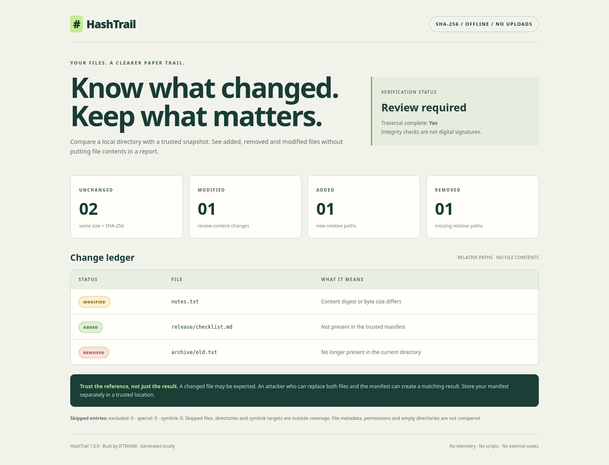
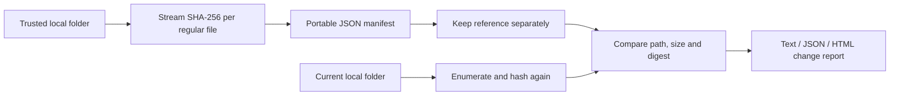

# HashTrail

**By IFTIKHAR** · Offline file integrity review · Python 3.11+ · MIT

[](https://github.com/specter-sec/hashtrail/actions/workflows/ci.yml)

**Know what changed. Keep what matters.** HashTrail creates a SHA-256 snapshot of a local directory, then shows which covered files were **added, removed or modified**. Use it to review a copied backup, compare a project handoff, or check a downloaded file collection against a reference you already trust.

**Files local rehti hain.** There are no uploads, credential requests, telemetry or third-party runtime dependencies. A checksum comparison is **not** a digital signature, malware scan, backup system or proof of chain of custody.

## Real screenshot

The report below was actually generated by `demo.py` from fictional local files. It shows one modified file, one added file, one removed file and two unchanged files. No real user data was used.



## Start without installing anything

```sh
git clone https://github.com/specter-sec/hashtrail.git
cd hashtrail
python3 --version  # Python 3.11 or newer
python3 -m hashtrail --version
```

Create a snapshot while you trust the source directory. Keep the manifest **outside that directory**, somewhere an attacker or accidental copy operation cannot silently replace it.

```sh
python3 -m hashtrail snapshot /path/to/original --output /tmp/original-manifest.json
python3 -m hashtrail verify /tmp/original-manifest.json /path/to/copied-folder
```

Paths in the manifest are relative, so the verification directory can be a different location. Both command outputs and input files stay on your computer. Choose new output filenames: the CLI will not overwrite an existing file or follow an output symlink.

### Optional console command

```sh
python3 -m venv .venv
. .venv/bin/activate
python -m pip install .
hashtrail snapshot /path/to/folder --output /tmp/folder-manifest.json
```

Runtime needs only Python's standard library. Optional package installation uses setuptools, which pip may download during build isolation; the checkout commands need no package installation. On Android Termux, install a supported Python and Git with `pkg install python git`, then use the checkout commands. Native Android and Windows execution are not certified by this project's Linux CI.

## Try the safe demo

Use a new directory that does not already exist:

```sh
python3 demo.py /tmp/hashtrail-demo
python3 -m hashtrail verify /tmp/hashtrail-demo/snapshot.json /tmp/hashtrail-demo/files
# Exit 1 is expected: the demo deliberately changes the file set.
```

Open `/tmp/hashtrail-demo/report.html` locally. It is a real report from the same comparison engine used by the CLI: self-contained, responsive, accessible HTML with no JavaScript, remote fonts or analytics. The generator creates a tiny binary file too; binary data is hashed rather than skipped.

## Review changes in your preferred format

```sh
python3 -m hashtrail verify /tmp/original-manifest.json /path/to/copied-folder --format json
python3 -m hashtrail verify /tmp/original-manifest.json /path/to/copied-folder --format html --output /tmp/integrity-review.html
```

Reports omit file contents. They still contain filenames, counts and security-relevant metadata. Manifests also contain byte sizes and content hashes, which can reveal or help guess known files. Keep both appropriately private.

### Exit codes

| Code | Meaning |
| --- | --- |
| `0` | Snapshot created successfully, or no covered file changes found |
| `1` | Verification completed and found added, removed or modified files |
| `2` | Invalid input, file operation failure, invalid manifest or incomplete verification |

An incomplete check takes priority over a change result. Do not treat a missing path in an incomplete comparison as a confirmed deletion: fix permissions or filesystem errors and run again. Shell redirection is controlled by your shell; use `--output` for HashTrail's no-overwrite and outside-input checks.

## Keep the scope explicit

```sh
python3 -m hashtrail snapshot ./project --exclude 'vendor/**' --exclude '*.tmp' --output /tmp/project-manifest.json
python3 -m hashtrail verify /tmp/project-manifest.json ./project
```

The manifest records user exclusion patterns, and verification reuses them automatically. Patterns use case-sensitive Python `fnmatch` on relative POSIX-style paths, **not** Git ignore semantics. Quote patterns to stop the shell expanding them. `*` can cross `/`; trailing `/` or `/**` selects a subtree. `.gitignore` is not read.

By default, directories named `.git`, `__pycache__`, `.venv` and `node_modules` are omitted. Symlinks and special objects such as sockets/FIFOs are never followed or hashed. Their counts appear in `skipped`, along with excluded entries. A skipped directory is one skipped entry, not a count of its unseen descendants. Skips do not by themselves make traversal incomplete.

`complete: true` means the traversal finished without a reported read, path or mutation error. It does **not** mean all filesystem objects are covered, that the directory was captured atomically, or that a matching directory is safe.

## What the manifest means

The version-1 JSON format stores `schema_version`, `algorithm`, `files`, `excluded_patterns`, `skipped`, `errors` and `complete`. Each file entry has a relative path, byte size and lowercase SHA-256 digest. No timestamps or absolute root paths are stored, which keeps equivalent snapshots reproducible.

The loader rejects unknown/duplicate keys, duplicate paths, invalid digests or sizes, unsafe traversal/absolute paths, backslashes, drive-prefixed paths and incomplete snapshots. It reads at most **8 MiB** of manifest data; the CLI refuses to create a manifest larger than that supported limit. Manifests are data, not executable instructions: verification enumerates the selected directory and compares maps rather than opening paths supplied by an untrusted manifest.

File content is hashed in bounded chunks; files do not need to fit in memory. The list of file entries and the parsed manifest do reside in memory. A filename containing backslashes or a leading drive-style prefix is outside this portable format and causes an incomplete snapshot instead of an unloadable manifest.

## How it works



`core.py` owns traversal, hashing, strict manifest loading and comparisons. `__main__.py` owns CLI policy and exit codes. `reports.py` produces content-free reports. `demo.py` creates only fictional data in a new directory.

HashTrail uses Python's [`hashlib.sha256`](https://docs.python.org/3/library/hashlib.html), not a custom cryptographic algorithm. It compares actual byte content, so a same-size modification is still detected. A rename appears as one removed path and one added path; rename inference is intentionally not attempted.

## Important limits

A party that can change both the directory and its reference manifest can produce a matching result. HashTrail does not sign, authenticate, encrypt or timestamp manifests. A trusted manifest must come from a separately trusted channel or protected storage. This is a practical integrity aid, not a forensic evidence or legal certification system.

Only file paths, bytes and byte sizes are compared. Permissions, ownership, timestamps, alternate streams, extended attributes, symlink targets, hardlink relationships and empty directories are not compared. HashTrail does not restore files or detect whether changed content is malicious. Hardlinked files are treated as separate paths.

Use a stable, trusted local filesystem. Descriptor checks and no-follow flags, where supported, reduce accidental races; they are **not** a sandbox against an adversary changing parent directories or swapping files concurrently. Some mutations can escape a before/after metadata check, and files are not read as an atomic directory-wide snapshot. Stop writers or use an operating-system snapshot when stronger consistency is needed.

## Tests and contributions

```sh
python3 -m unittest discover -s tests -v
python3 -m compileall -q hashtrail tests demo.py
```

CI tests Python 3.11, 3.12 and 3.13 and runs a real CLI snapshot/verify round trip. Check [GitHub Actions](https://github.com/specter-sec/hashtrail/actions) for the result of a specific revision; the presence of commands here is not a claim that another checkout passed.

Read [CONTRIBUTING.md](CONTRIBUTING.md) for development and privacy requirements, and [SECURITY.md](SECURITY.md) for responsible disclosure. Future work includes signed-reference integration, explicit metadata policies and native cross-platform CI. These are not current features.

Original code and documentation: [MIT](LICENSE). Built by **IFTIKHAR**.
